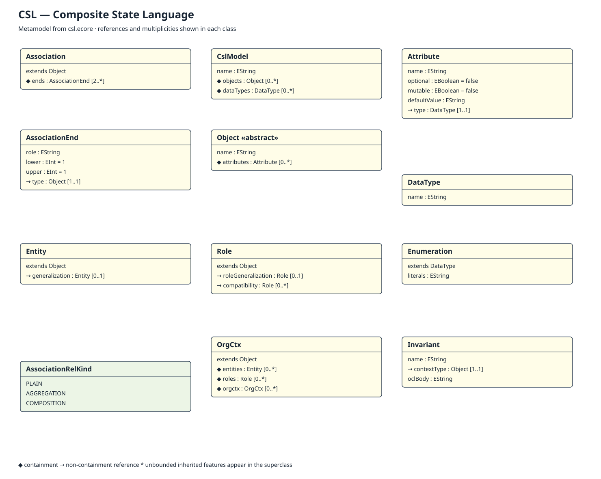

# Installation and Model View Guide

This folder contains the Ecore metamodels for CSL, iStar, BPMN, and NormML. The steps
below show how to open their class-diagram views in Eclipse.

## Install the required Eclipse tools

Install **Eclipse Modeling Tools**, then make sure the following components are
available:

- EMF (Eclipse Modeling Framework)
- Sirius
- EcoreTools

You can install missing components from **Help > Eclipse Marketplace** or
**Help > Install New Software**.

## Import and open the models

1. Start Eclipse and select **File > Import**.
2. Choose **General > Existing Projects into Workspace**, then click **Next**.
3. Select the `docs/model` directory from this repository.
4. Clear **Copy projects into workspace** and click **Finish**.
5. Switch to the **Design** perspective.
6. Open **Window > Show View > Other > Sirius > Model Explorer**.
7. Expand one of the `.aird` files and double-click its model representation:

   | File | Model representation |
   |---|---|
   | `csl.aird` | `CslMetamodel` |
   | `istar.aird` | `IstarMetamodel` |
   | `bpmn.aird` | `BpmnMetamodel` |
   | `normml.aird` | `NormMLMetamodel` |

If a diagram opens without any elements, right-click the canvas and select
**Refresh**. Do not use the **Class** tool simply to make the existing classes
appear, because it creates a new class in the `.ecore` file.

# The Modeling Languages

## CSL

CSL describes the structural part of a system, including data types, entities,
groups, roles, attributes, and relationships. Open `csl.ecore` to inspect the
metamodel or `csl.aird` to see its diagram.



## iStar

iStar describes the goals and intentions of system actors. Its model includes
actors, goals, tasks, resources, qualities, refinements, and dependencies. Open
`istar.ecore` or the `IstarMetamodel` representation in `istar.aird`.


## BPMN

BPMN describes system processes and their execution flow through lanes,
activities, gateways, events, and sequence flows. Open `bpmn.ecore` or the
`BpmnMetamodel` representation in `bpmn.aird`.


## NormML

NormML is independent of the iStar, BPMN and CSL metamodels. Open
`normml.ecore` or **NormMLMetamodel** in `normml.aird`. Subjects, resources and
datatypes are local declarations. `If.condition` contains a `Condition` with
OCL text; the evaluator supplies the shared CSL state and the binding of `self`.
The metamodel itself does not implement that evaluator.

See [concept and relation rationale](normml-design.md).
The schema URI is `https://vnu.edu.vn/sme/goal/normml/2.0`.
The two XMI fixtures are self-contained.

Existing concept bounds were recovered from Eclipse Local History and saved in
`tools/normml-layout.json`. The diagram generator preserves subsequent Eclipse
position/size edits; `--restore-layout` restores the recovered baseline.
New concepts are placed to the right of that baseline.

With Java 21 and `ECLIPSE_PLUGINS` set to the installed Eclipse Modeling Tools
`plugins` directory, run from the repository root:

```sh
javac -cp "$ECLIPSE_PLUGINS/*" -d /tmp docs/model/tools/ValidateNormML.java
java -cp "/tmp:$ECLIPSE_PLUGINS/*" ValidateNormML
javac -cp "$ECLIPSE_PLUGINS/*" -d /tmp docs/model/tools/ValidateNormDiagram.java
java -cp "/tmp:$ECLIPSE_PLUGINS/*" ValidateNormDiagram "$ECLIPSE_PLUGINS"
```

Validation covers Ecore and OCL invariants, standalone loading, fixture roundtrip,
negative date boundaries, composite cycles and action/resource compatibility.
Diagram validation checks persisted Sirius/GMF and GenModel references.

## CSL naming

CSL means **Composite State Language**. Project source packages, classes,
metamodel namespaces, fixtures and file extensions use CSL consistently.
See [migration notes](csl-migration.md).
